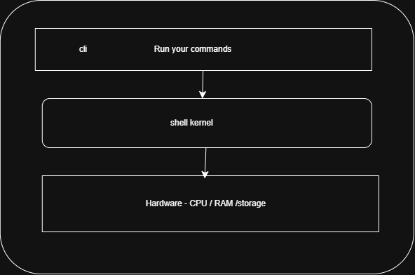
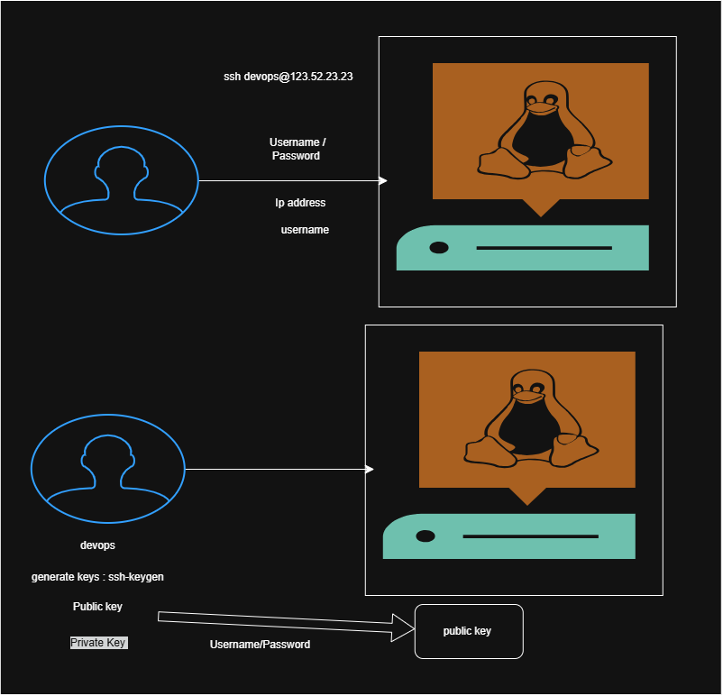
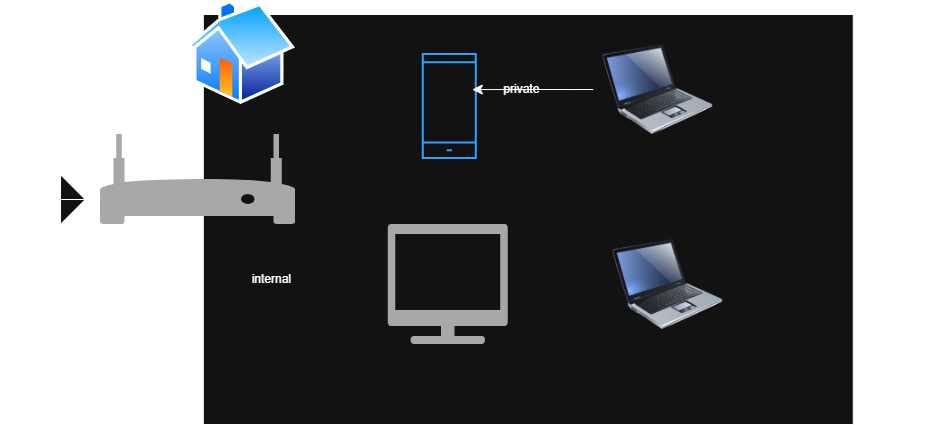

# Servers and operating systems

## Virtual machines

A physical machine provides CPU, memory, storage, and network resources directly. A virtual machine (VM) is software that uses resources allocated by a physical host.

VMs are commonly created with:

- **On-premises:** VMware vSphere, Hyper-V, or KVM
- **Cloud:** Amazon EC2, Azure Virtual Machines, or Google Compute Engine

On-premises infrastructure has higher setup and maintenance costs because the organization owns and operates the hardware. Cloud infrastructure has lower upfront cost and is managed through a pay-as-you-use model.

## Operating systems

Windows and Linux are operating systems. Linux is the kernel, while distributions such as Ubuntu, RHEL, Debian, Fedora, and SUSE add tools and packages.

Linux was created by Linus Torvalds in 1991 and is open source.

- A GUI is a graphical interface.
- A CLI is a command-line interface.
- Most servers run Linux in CLI mode.

## Linux system areas

1. User management
2. Package management
3. Service management
4. Process management
5. Network management

## Authentication and authorization

- **Authentication** verifies identity, for example through a password or SSH key.
- **Authorization** defines allowed actions, for example read, write, or execute.

Server authentication can use:

1. Password-based authentication
2. Key-based authentication

For AWS EC2 key pairs, the private key (`.pem`) is downloaded to the local machine. Keep it secure and do not share it.

## Private and public IP addresses

- A **private IP** identifies a server inside a private network and is not directly reachable from the internet.
- A **public IP** is used for internet-facing communication.

