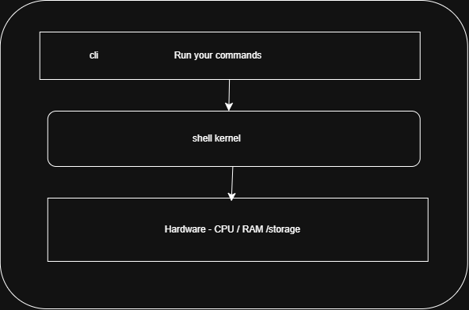
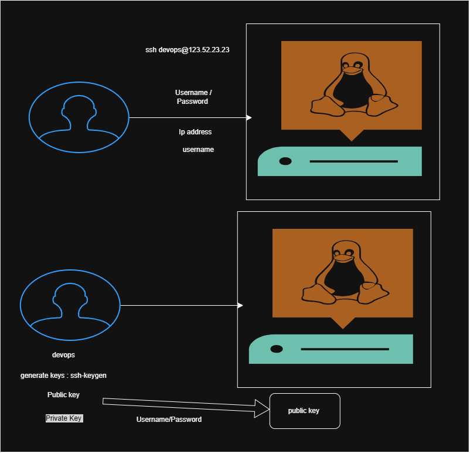
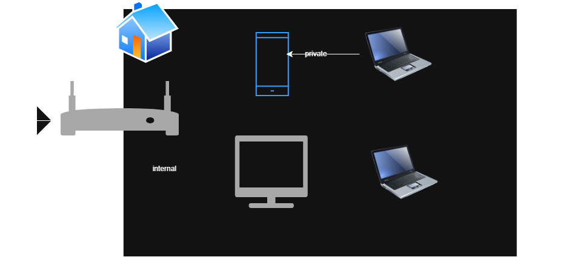

### Virtual machines / Virtual server / server :
* Imagine yur laptop -  RAM / CPU /Harddisk  - Physical machine 
* virtual machine is something which is not available with out , you can access via network or internet.

### Where these servers are created? :
* on-premise - vmsphere / vmware / hyper-v / kvm
* cloud - AWS / Azure / GCP


* onpremise initial cost is too high . maintaining cost is also high. requires teams to manage and configure the servers.
* Onpremise is prefarable while you have at long time own application  

* cloud initial cost is low. maintaining cost is also low. requires less teams to manage and configure the servers.


## Operating system :
* windows  in laptop - size of the OS is 20 GB
* linux in laptop - size of the OS is 2 GB 

* GUI - laptop - windows / ubuntu / centos / fedora
* CLI - Command line interface servers

* Servers - 96 % of the servers are linux CLI based.

* EX : ubuntu / centos / fedora / debian / redhat / suse / kali linux

* ```linux``` is a kernal on top of it we have OS - ubuntu / centos / fedora / debian / redhat / suse / kali linux

* linux is developed by ```linus torvalds``` in 1991. it is open source and free to use.


### Linux os operating system :



1. User Management 
2. Package Management
3. Service Management
4. Process Management
5. Network Management


### Authentication and Authorization ;
* Authentication - process of verifying the identity of a user or system. (username / password)
* Authorization - what action you can do inside the system. (read / write / execute)

## Two ways of authentication of server :
1. Password based authentication - username / password
2. Key based authentication - public key / private key

* In AWS - while creating keypair with .pem , the private key is downloaded to your local  




## Private ip and private ip address :
* Private ip address - Internal purpose we use private ip address. it is not reachable from outside the network.
* Public ip address - External purpose we use public ip address. it is reachable from outside the network. (internet)


