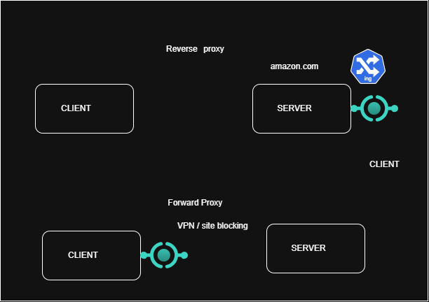
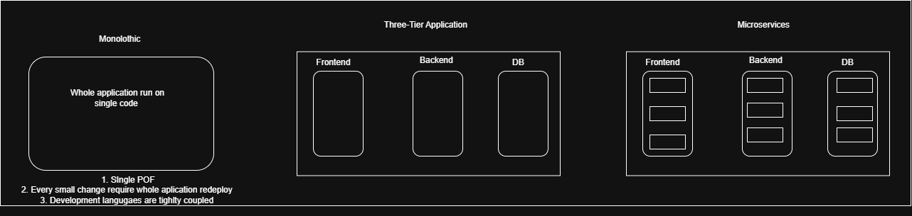

### Package Management :
* Install packages , update packages , remove packages , search 
* RHEL -9 the package manager  dnf 

* Install package 
    *  dnf install <packagename>
* Update package 
    * dnf update <packagename>
* Remove package 
    * dnf remove <packagename>
* List all installed packages 
    * dnf list installed 
* List available 
    * dnf list available 

* Search for the packages :
    * dnf search java-11-openjdk


* Install git :
    ```
    dnf install git -y 
    ```

### AWS change instance type :
* We change the instance type without terminating the server. To do that 
    1. Stop the server 
    2. Change the intance type 
    3. start the server 
* The private ip of the server , wont chamnge even the server is stops/rrestarted
* But the public ip will changes with start/restart 

* Remove package :
    ```
    dnf remove <packagename> -y 
    ```
* GIt - Is a packagement 
* nginx - Runs as a service in your server . It is a popular frontend webserver , which holds the html, css, .js file 
* nginx is popular for reverse proxy 
* forward proxy - VPN , you hide your identity 
* client - server 
* laptop - client  >>> amazon.com - server 



### Service Management :
* systemctl 
    * status _ show the status of a service 
    * start - start the service 
    * stop  - stop the service 
    * restart - restart the service 
    * enable - when server restart hapnes , it takes care of auto start 
```
sudo systemctl  status/start/stop/restart/enable <servicename>
```


### Process Management :

* ps -ef - list all processes runnig
* kill <Processid>
* kill -9 <processid> 
* top - view real time running processes and resources usage 

### Network Management:

* Install net-tools for netstat :
    ```
    sudo dnf install net-tools -y
    ```
* netstat -lntp 
* ping <ipaddress>
* telnet <ipaddress> 80 

### Monolithic vs Three tier application vs Microservices 
* frontend - html/CSS/react.js  
* backend - nodejs / java / python /.net 
* Databses - SQL: Mysql  , Nosql: Mongodb 
