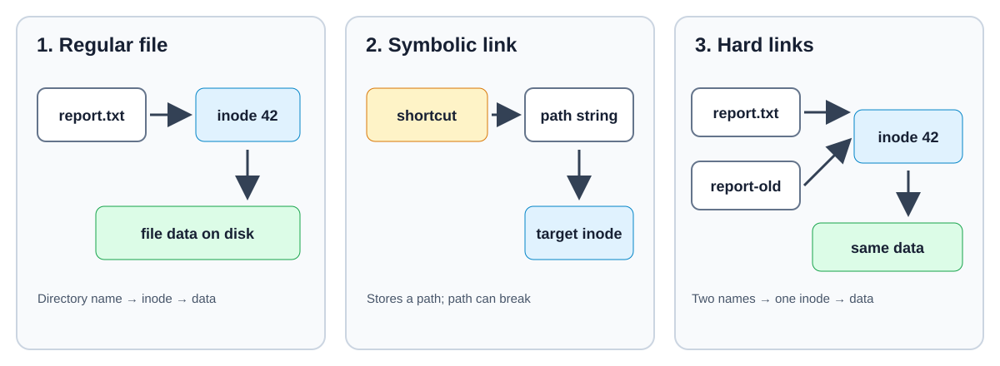
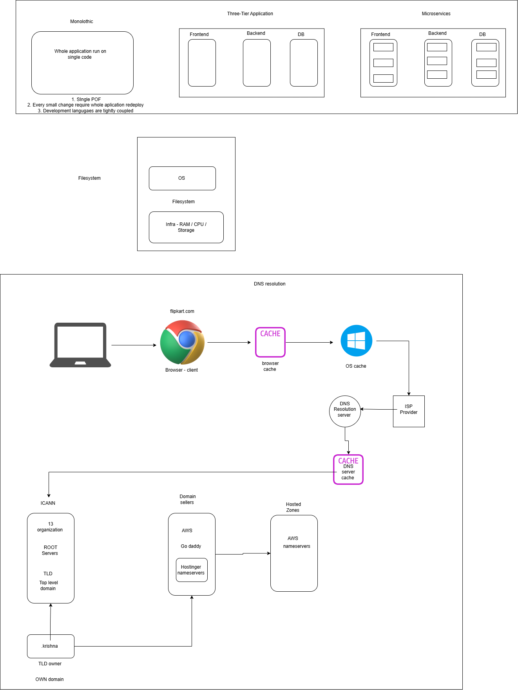

# RHEL: Resource check 
## CPU

| Check | Command |
|---|---|
| CPU model, sockets, cores, and threads | `lscpu` |
| Number of available logical CPUs | `nproc` |
| Live CPU and process usage | `top` (press `q` to exit) |
| CPU usage summary (if installed) | `mpstat 1 5` (`sudo dnf install sysstat` if needed) |

## RAM (Memory)

| Check | Command |
|---|---|
| Total, used, available, and swap | `free -h` |
| Detailed memory figures | `cat /proc/meminfo` |
| Live memory and process usage | `top` (press `q` to exit) |

## Storage

| Check | Command |
|---|---|
| Filesystem space and usage | `df -hT` |
| Disks, partitions, and mount points | `lsblk -f` |
| Size of a directory | `du -sh /path/to/directory` |

## Quick check

```bash
lscpu
free -h
df -hT
lsblk -f
```

## Filesystem and folders

A **filesystem** is a method used by operating syatem to organize and manage files and folders on a storage device.

Linux stores every file and folder below `/`, which is called the root folder.

| Folder | Simple meaning |
|---|---|
| `/` | Main starting point of the filesystem |
| `/home` | Personal folders for normal users |
| `/root` | Personal folder for the root user |
| `/etc` | System configuration files |
| `/var/log` | System and application logs |
| `/tmp` | Temporary files |
| `/usr/bin` | Common commands and applications |
| `/boot` | Files used when Linux starts |
| `/dev` | Disk and device entries |
| `/mnt` | Folder for mounting storage |
| `/media` | Removable storage such as USB drives |

```text
/                     Root folder
├── home/             Normal users
├── root/             Root user
├── etc/              Configuration
├── var/
│   └── log/          Logs
├── tmp/              Temporary files
├── usr/
│   └── bin/          Commands
├── boot/             Startup files
└── dev/              Devices
```

Use `pwd` to find the current folder and `ls` to view its contents:

```bash
pwd
ls /
cd /etc
```

# Inodes, Symlinks, and Hard Links (RHEL)



## Inode

An **inode** is the filesystem record for a file. It stores metadata and points to the file’s data; the filename lives in a directory entry and refers to the inode.

```bash
ls -i report.txt   # show the inode number
df -ih             # check inode usage
```

## Links: symlinks and hard links

A **link** is another way to reach a file. Think of a file as a document in a filing cabinet:

- A **symlink** is like a note that says where the document is.
- A **hard link** is like a second label attached to the same document.

The inode is the file's identity on disk. A hard link shares that identity; a symlink has its own identity and stores a path to follow.

### Symbolic link (symlink)

A **symbolic link**, or **symlink**, is a separate small file that stores the path to another file or folder. It creates a new link location, but it does **not** create another copy of the target's contents. Opening the link follows its stored path to the original target.

For example, `/var/log/test` can be the symlink location and `/home/ec2-user/test` can be the target location:

```text
/var/log/test -> /home/ec2-user/test
```

Both paths can be used to access the same target contents. The symlink itself is a separate filesystem entry; if the target is moved or removed, the stored path may no longer work.

General syntax:

```text
ln -s <target-path> <link-name>
```

`<target-path>` is the existing file or folder; `<link-name>` is the new shortcut.

#### Example 1: Symlink to a file

Start in a new demo folder. If `~/symlink-file-demo` already exists, use a different folder name.

```bash
mkdir ~/symlink-file-demo
cd ~/symlink-file-demo
printf "Hello from the original file.\n" > report.txt
cat report.txt
```

Create a link called `report-link.txt` that points to `report.txt`, then check and read through the link:

```bash
ln -s report.txt report-link.txt
ls -l report-link.txt
readlink report-link.txt
cat report-link.txt
```

Remove the symlink with `rm` and confirm that the original file is still there:

```bash
rm report-link.txt
ls report.txt
cat report.txt
```

#### Example 2: Symlink to a folder

This example links `/var/log/test` to `/home/ec2-user/test`. The target folder must exist. If needed, create it first:

```bash
mkdir -p /home/ec2-user/test
```

Folder symlink syntax:

```text
ln -s <target-folder> <symlink-path>
```

- `<target-folder>` is the existing folder to access.
- `<symlink-path>` is where you want the new shortcut to appear.

Make sure `/var/log/test` is not already an existing file or folder. Then create the symlink:

```bash
sudo ln -s /home/ec2-user/test /var/log/test
```

Check the link and list the target folder's contents through it:

```bash
ls -ld /var/log/test
ls -la /var/log/test
cd /var/log/test
```

The `ls -ld` output should show `/var/log/test -> /home/ec2-user/test`. Remove only the symlink with `unlink`; the target folder and its contents remain:

```bash
sudo unlink /var/log/test
ls -la /home/ec2-user/test
```

Do not use `rm -r` to remove a symlink; it can delete a real directory and its contents if the path is not a symlink.

### Hard link

A **hard link** is a second filename for the same file data. Both names refer to the same inode, so they are two names for one file—not two separate copies.

#### Create a hard link 

Use a different new folder for this demonstration. If `~/hardlink-demo` already exists, choose another new folder name.

```bash
mkdir ~/hardlink-demo
cd ~/hardlink-demo
printf "Hello from the original file.\n" > report.txt
cat report.txt
```

Create a second name, `report-hardlink.txt`, for `report.txt`:

```text
ln <existing-file> <new-name>
```

```bash
ln report.txt report-hardlink.txt
```

Check both names and compare the inode numbers at the start of each line. They should match:

```bash
ls -li report.txt report-hardlink.txt
```

Append text using the hard-link name, then read the updated content using the original name. Both names access the same file data:

```bash
printf "Added through the hard link.\n" >> report-hardlink.txt
cat report.txt
```

Remove the original name. The hard link still accesses the data:

```bash
rm report.txt
cat report-hardlink.txt
```

Hard links generally work only on the same filesystem and are normally not used for folders. The data remains available as long as at least one hard-link name still exists.

### What happens when the original name is removed?

- **Symlink:** It stores the original path. If the file at that path is removed or renamed, the symlink becomes broken.
- **Hard link:** Removing one filename does not remove the file data while another hard-link name remains. You can still open the file through that remaining name.

### Real-world use cases

**Symlink — switch Node.js versions**

Keep each Node.js release in its own folder and use `current` as the stable path that points to the version you want to run:

```text
/opt/nodejs/
├── node-v20.18.0-linux-x64/
├── node-v22.11.0-linux-x64/
└── current -> node-v22.11.0-linux-x64
```

After extracting the release folders, create the symlink to the version to use. Run the first command only if `/opt/nodejs/current` does not already exist. The example version names are illustrative; use the folders that actually exist on your server.

```bash
sudo ln -s /opt/nodejs/node-v20.18.0-linux-x64 /opt/nodejs/current
/opt/nodejs/current/bin/node --version
```

To switch to the other extracted version, update the symlink and check it:

```bash
sudo ln -sfnT /opt/nodejs/node-v22.11.0-linux-x64 /opt/nodejs/current
readlink /opt/nodejs/current
/opt/nodejs/current/bin/node --version
```

An application configured to use `/opt/nodejs/current/bin/node` will use the selected version when it starts. Restart running Node.js applications after switching; an already-running process does not change versions.

The application or service must use the stable `current` path for this version-switching pattern to work.

Symlinks are also useful for making a file or folder available at a convenient path without moving it.

**Hard link — save space in backups**

Some backup tools use hard links for files that have not changed between snapshots. Each backup can show a complete directory tree, while unchanged files share the same data on disk. The linked files must be on the same filesystem.

Hard links can also give one file another name without storing a second copy. Remember that editing the data through either name changes the same file.

### Quick comparison

```text
+------------------------------+------------------------------+
| SYMBOLIC LINK (SYMLINK)      | HARD LINK                    |
+------------------------------+------------------------------+
| Stores a path to a target.   | Another name for the same    |
|                              | file data (same inode).      |
+------------------------------+------------------------------+
| Has its own inode.           | Shares the target's inode.   |
+------------------------------+------------------------------+
| Can point across filesystems | Must be on the same          |
| and to folders.              | filesystem; usually not for  |
|                              | folders.                     |
+------------------------------+------------------------------+
| May stop working if the      | Still works if another hard  |
| target is moved or removed.  | link name remains.           |
+------------------------------+------------------------------+
```

**In short:** Use a symlink when you want a shortcut to a path. Use a hard link when you want another name for the same file data.


# DNS resolution

**DNS (Domain Name System)** is like the internet's address book. It translates names such as `example.com` into IP addresses that computers use to find servers. **DNS resolution** is this lookup process.

Check how a domain name resolves on Linux:

You can use `nslookup` or `dig` for more details. On RHEL, install them with:

```bash
sudo dnf install bind-utils -y
nslookup google.com
```

DNS resolution finds an address; it does not by itself confirm that the server or website is reachable.


